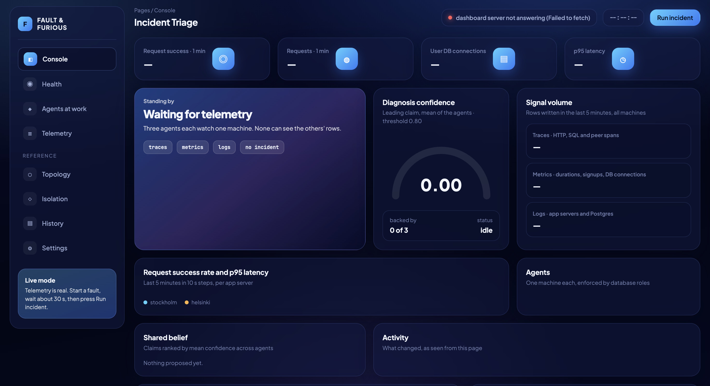

# Fault & Furious

Fault & Furious is a course-demo system for investigating incidents from telemetry
split across multiple machines. Three agents each see only their own machine's
telemetry, exchange claims, and combine evidence to form a diagnosis.

## Dashboard preview



*UI preview captured while the dashboard API was unavailable. Run the local stack
below to see live telemetry and agent state.*

## Run locally

Requirements: Docker Desktop or Docker Engine with Docker Compose v2.

```sh
docker compose up -d --build
```

Open the dashboard at [http://localhost:9000](http://localhost:9000). The two
sample forum servers are at [http://localhost:8001](http://localhost:8001) and
[http://localhost:8002](http://localhost:8002). Allow about 30 seconds for
telemetry to populate. The dashboard can start an investigation and, locally,
inject the signup-surge and network-split demo faults.

Stop the services while preserving their data:

```sh
docker compose down
```

To remove the local database volumes and all demo data as well:

```sh
docker compose down -v
```

## What the demo shows

- **Signup surge:** Vantaa records PostgreSQL `53300` connection refusals; the
  Stockholm and Helsinki agents observe failed SQL calls. Together, these clues
  distinguish cause from symptom.
- **Network split:** Stockholm and Helsinki report `PEER_UNREACHABLE`; Vantaa
  sees a healthy database.
- **Quiet traffic:** agents should avoid inventing an incident.

The default agent mode is a deterministic mock, so the demo runs without a model.
Optional local Ollama support and agent API details are in
[`agent/README.md`](agent/README.md).

## Architecture

| Part | Responsibility |
|---|---|
| Stockholm and Helsinki | FastAPI forum servers that emit spans, logs and metrics through `otel.py` |
| Vantaa | PostgreSQL user database; `dbmon` records its logs and connection metrics |
| Telemetry database | Stores rows tagged by `source`; PostgreSQL row-level security limits each agent to its own source |
| Three agents | Read their own telemetry, exchange belief states and merge evidence |
| Dashboard | Displays agent state and telemetry; local fault controls are disabled in the public deployment |

## Checks

Run these against the local Compose stack:

```sh
./check.sh                 # trace, child span, log and metric linkage
telemetry/check.sh         # telemetry roles and row isolation
agent/check.sh stack       # agent convergence and integrated stack checks
```

## Deployment and scope

[`DEPLOY.md`](DEPLOY.md) describes the authenticated reviewer deployment using
Docker Compose and Caddy. Public hosting requires a server and DNS names; the
local dashboard and agent APIs should not be exposed directly.

This repository is a synthetic course demo, not a production service for real
accounts or telemetry. Do not enter real credentials or sensitive data. The
historical proposal and course brief are retained in [`overall-idea.md`](overall-idea.md),
[`1-distributed-telemetry-store.md`](1-distributed-telemetry-store.md), and
[`BRIEF.md`](BRIEF.md); the implemented scope is the three-machine system described
above.

## Project notes

- [`telemetry/README.md`](telemetry/README.md): schema, roles and retention.
- [`agent/README.md`](agent/README.md): endpoints, mock/model modes and agent checks.
- [`DEPLOY.md`](DEPLOY.md): reviewer deployment instructions.
